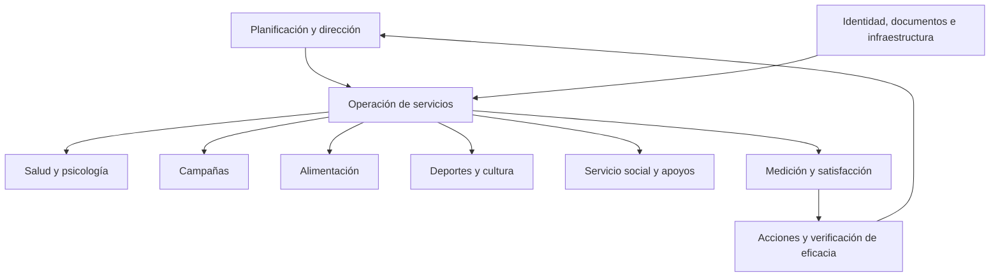

# 09 · Mapa de procesos propuesto

Modelo conceptual, no BPMN ejecutable ni mapa institucional validado. Responsable propuesto: coordinación de bienestar; dueños por servicio pendientes de designación.
