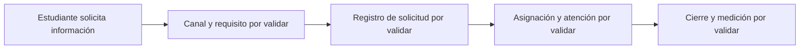

# 10 · AS-IS: investigación pendiente

No se ha observado la operación actual. El AS-IS siguiente es una **hipótesis de entrevista** aportada por la problemática; no describe un hecho verificado de la UNAJ.

Entrevistas: ¿qué cubre SIGBU?, ¿cómo se define elegibilidad?, ¿cómo se gestionan urgencias?, ¿quién ve cada dato?, ¿cuáles son los estados vigentes?, ¿cómo se mide desperdicio? Registrar fecha, fuente autorizada y evidencia anonimizada antes de establecer brechas.
