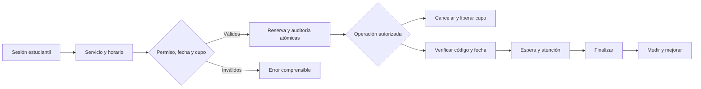

# 11 · TO-BE propuesto

Comedor sustituye espera/atención por entrega única. Campaña multiestación y gimnasio con aforo físico requieren extensiones, no se deducen del flujo genérico. BPMN 2.0 con pools, eventos y excepciones queda pendiente de validar el AS-IS.
