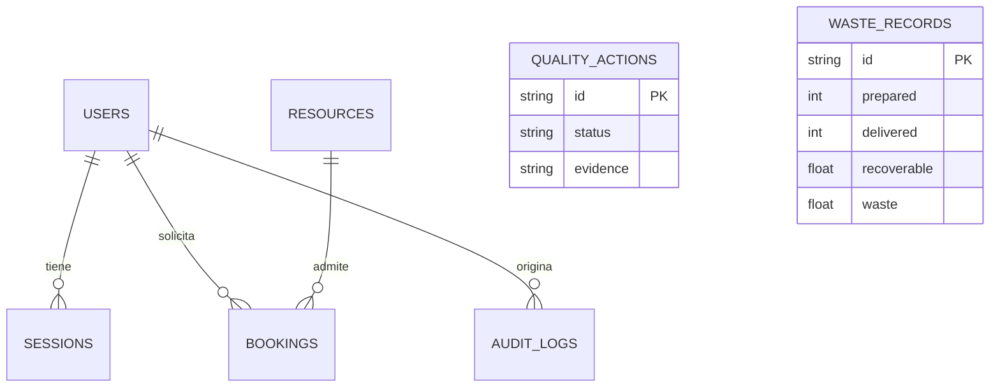

# 12 · Modelo de dominio

Agregados actuales: Usuario, Sesión, RecursoHorario, Reserva, AcciónCorrectiva, RegistroProducción y EventoAuditoría. Un recurso contiene una franja; una reserva referencia usuario y recurso. No hay almacenamiento clínico.

El agregado genérico facilita el primer incremento; no reemplaza las entidades específicas de campañas por estaciones, beneficiarios, expedientes ni ocupación física.
