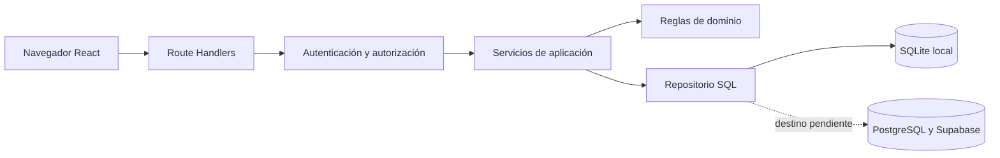
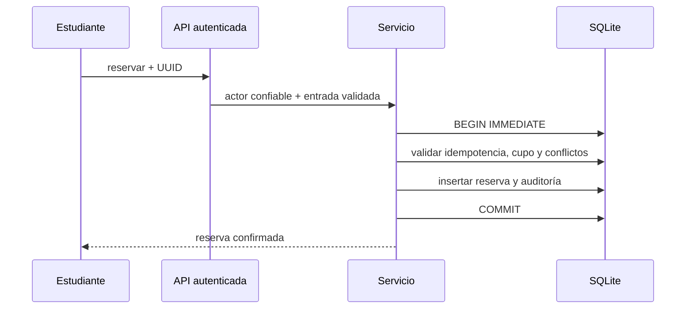

# 13 · Arquitectura

Monolito modular Next.js App Router. Presentación en componentes cliente, HTTP en Route Handlers, reglas puras en dominio, transacciones y casos de uso en servicio y persistencia SQL local. El repositorio SQLite aún es compartido: extraer interfaces por dominio antes de ampliar.

No microservicios, no consultas SQL desde navegador, sin conexiones institucionales. Sesión actual se resuelve exclusivamente en servidor.
