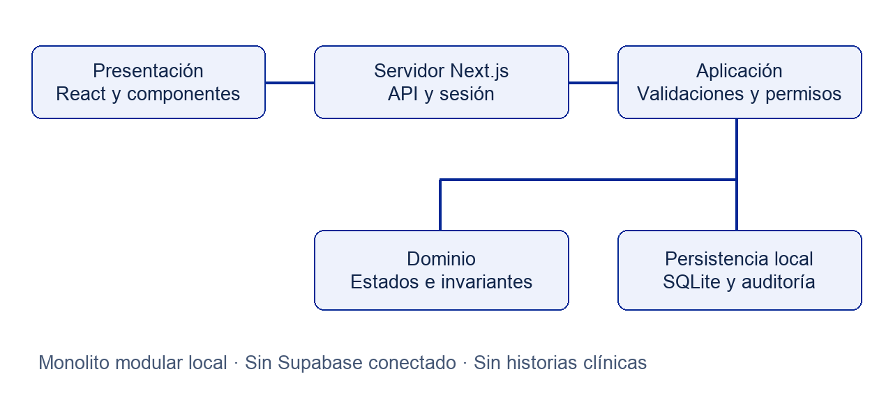
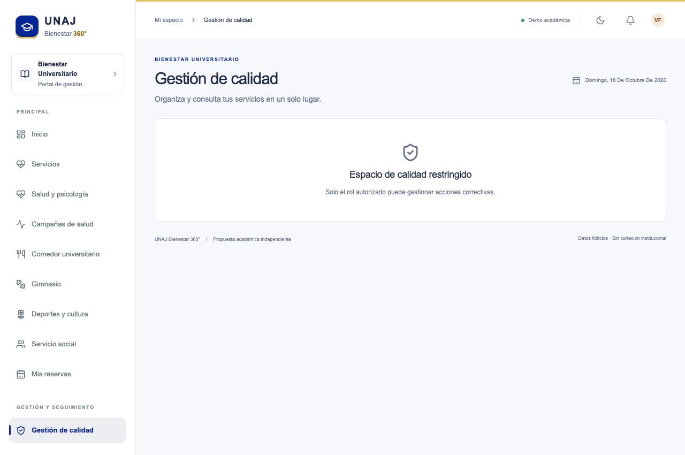
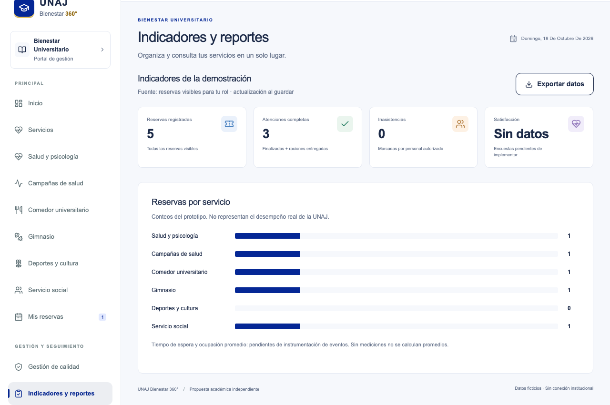

> Texto auxiliar. La maquetación APA 7 y el índice actualizado se encuentran en las versiones Word y PDF.

# UNAJ Bienestar 360°: Aplicativo de Gestión de Bienestar Universitario como Herramienta de Apoyo al Sistema de Gestión de Calidad ISO 9001:2015

Escuela Profesional de Ingeniería de Software y Sistemas

Curso Gestión de Calidad

Versión académica basada en el código existente y en pruebas con identidades ficticias.

Referencia de software: commit 27c5d97 del repositorio HEYLER1/unaj-bienestar-360.

Autor o integrantes, docente y ciclo o sección: no proporcionados en la solicitud.

Juliaca, Perú
18 de octubre de 2026

No es software oficial de la UNAJ. No acredita certificación ni conformidad integral con ISO 9001.

---

## Índice

Índice de navegación con capítulos y páginas de la versión Word y PDF.

---

## Introducción y descripción del aplicativo

UNAJ Bienestar 360° es un prototipo académico de gestión administrativa desarrollado para demostrar reservas, control de estados y seguimiento de acciones de calidad en servicios de bienestar universitario. Este informe analiza la versión del repositorio HEYLER1/unaj-bienestar-360, identificada por el commit 27c5d97, y la contrasta con pruebas y capturas generadas en una copia local aislada.

El resultado principal de la revisión es que el aplicativo aporta registros y controles útiles para apoyar procesos de calidad, especialmente el control operacional y el seguimiento de acciones. No constituye un Sistema de Gestión de Calidad completo ni prueba que una organización cumpla ISO 9001. Tampoco se ha evaluado con usuarios o datos institucionales reales.

ISO presenta la gestión por procesos, el enfoque al cliente y la mejora continua entre los fundamentos de la familia ISO 9000 (International Organization for Standardization [ISO], s. f.). En este trabajo el usuario del servicio universitario se considera destinatario de la atención; ello no reemplaza la definición institucional de partes interesadas y requisitos.

### Nota sobre la edición académica

Se utiliza ISO 9001:2015 porque es la edición solicitada por el curso. En la consulta del 18 de octubre de 2026, la ficha de ISO identifica esa edición como sustituida por ISO 9001:2026. El análisis mantiene los numerales de 2015 y no pretende orientar una certificación vigente (ISO, 2015).

### Método de revisión

Se inspeccionaron reglas, servicios, persistencia y controles HTTP; se ejecutaron pruebas disponibles y se recorrieron pantallas con Playwright. Se distinguió inspección de código, ejecución de prueba y resultado operativo simulado. Las modificaciones se limitaron al arnés temporal de verificación; no se cambió el código fuente original.

---

## Problemática objetivos y justificación

### Problemática

El proyecto plantea riesgos de dispersión de solicitudes, dificultad para reservar, control insuficiente de cupos y falta de seguimiento de mejoras. Estas situaciones proceden del planteamiento académico y no han sido confirmadas por entrevistas ni mediciones institucionales. No es válido atribuir a la UNAJ una ausencia actual de digitalización.

El portal de la universidad informó la presentación de SIGBU el 16 de marzo de 2026, orientado a gestionar servicios de bienestar (Universidad Nacional de Juliaca, 2026). La propuesta aquí analizada es independiente y no sustituye, evalúa ni presume deficiencias del SIGBU.

### Objetivo general

Analizar y demostrar cómo las funciones verificadas de UNAJ Bienestar 360° pueden apoyar la operación y revisión de procesos de bienestar dentro de un enfoque de gestión de calidad basado en ISO 9001:2015.

### Objetivos específicos

1. Verificar los flujos disponibles y sus límites de seguridad y persistencia.

2. Relacionar funcionalidades y evidencias con ocho numerales de ISO 9001:2015.

3. Describir un ciclo PHVA para la campaña ficticia sin atribuir funciones pendientes.

4. Preparar evidencias reproducibles y procedimientos de demostración.

### Justificación

El aporte académico consiste en conectar controles de software con decisiones de gestión: una reserva se convierte en registro, un estado permite seguir una atención y una acción conserva evidencias para revisión. La utilidad esperada debe validarse con responsables y usuarios antes de inferir eficiencia, satisfacción o reducción de desperdicio.

---

## Procesos y funcionalidades implementadas

| Proceso | Función verificada | Límite principal |
| --- | --- | --- |
| Acceso | Inicio y cierre con cuatro cuentas ficticias | Sin registro público ni recuperación |
| Salud y psicología | Reserva, cancelación, cupo y privacidad por recurso | Sin historia clínica ni seguimiento profesional completo |
| Campaña | Inscripción y espera, atención y finalización general | Sin estaciones ni prioridades |
| Comedor | Reserva, entrega única y registro manual de producción | Sin elegibilidad ni pronóstico integrado |
| Gimnasio | Reserva y estados de llegada y salida administrativa | Sin control de aforo físico |
| Actividades y social | Catálogo y reserva administrativa | Sin expediente, convocatorias ni catálogo editable |
| Calidad | Acción, responsable, fecha y dos etapas de evidencia | Sin no conformidad formal ni verificador independiente |
| Reportes | Conteos por rol y exportación CSV | Sin tiempos ni satisfacción medidos |

### Roles observados

Las cuentas de Lucía y Diego tienen rol estudiante. Gestión reúne coordinación, médico, comedor, gimnasio y calidad. Técnico conserva un rol sin permiso operativo ni acceso a reservas de terceros. El tipo de dominio contempla también psicólogo, pero no hay una cuenta psicológica semilla ni asignación individual de profesionales. El esquema PostgreSQL propone catorce roles, lo que no equivale a tenerlos operativos en el prototipo local.

---

## Arquitectura general

La versión ejecutada mantiene un monolito modular: la presentación llama a Route Handlers; el servidor resuelve la sesión y valida las entradas; el servicio aplica permisos y reglas; SQLite conserva reservas, sesiones, auditoría y acciones. El navegador no construye consultas SQL.

### Persistencia y controles

SQLite utiliza claves foráneas, índice único parcial y transacciones BEGIN IMMEDIATE. El servicio comprueba cupos, duplicados y conflictos antes de insertar; los cambios operativos se auditan. La sesión utiliza un token opaco y las contraseñas ficticias se guardan como hash scrypt con sal. Las mutaciones comprueban el origen de la solicitud.

La migración PostgreSQL incluida es una propuesta de destino no aplicada en esta revisión. Supabase Auth y RLS no están conectados. La seguridad local comprobada no acredita una solución sanitaria o multiinstancia de producción.

---

## Relación con ISO 9001 y matriz primera parte

La matriz describe apoyo parcial, no cumplimiento normativo ni certificación. Los requisitos se parafrasean para el análisis; la evaluación formal requiere el texto autorizado y evidencia organizacional. E01-E25 identifican capturas reales del escenario ficticio.

| ISO | Requisito relacionado | Funcionalidad implementada | Evidencia | Beneficio de gestión |
| --- | --- | --- | --- | --- |
| 4.4 | Definir procesos, sus relaciones, responsabilidades y controles. | Catálogo por servicio y estados de reserva; mapa de procesos documentado. | E03 y E13-E15; src/domain/rules.ts; docs/09-process-map.md. | Hace visible el flujo administrativo y facilita identificar sus controles. |
| 5.1.2 | Orientar la gestión a las necesidades del usuario y a requisitos aplicables. | Portal estudiantil simple, consulta de cupos, reserva y cancelación propia. | E02, E03, E08 y E24; src/components/service-catalog.tsx. | Facilita el acceso y da al estudiante visibilidad del estado de su solicitud. |
| 6.1 | Considerar riesgos y oportunidades y planificar acciones proporcionales. | Validaciones de cupo, fecha, duplicados, conflicto horario y permiso; transacción de reserva. | src/server/service.ts; tests/service.test.ts; E23 y pruebas de último cupo. | Reduce la exposición técnica a sobrecupos y operaciones no autorizadas dentro del alcance probado. |
| 7.5 | Mantener y controlar la información documentada necesaria para operar. | Reservas y cambios persistentes; historial de evidencias de calidad; documentación versionada en Git. | E06, E20, E21; src/server/db.ts; quality_action_history y audit_logs. | Conserva información para revisar qué se registró y quién efectuó la operación. |

### Brechas que impiden una conclusión de conformidad

4.4. No hay diseñador de procesos ni responsables configurables; el mapa es propuesto y no está validado institucionalmente.

5.1.2. La interfaz no demuestra liderazgo de la dirección ni conocimiento validado de necesidades. Encuestas y análisis de satisfacción no implementados.

6.1. No existe registro de riesgos, evaluación de impacto/probabilidad ni seguimiento de oportunidades en la interfaz. No se ha medido reducción de riesgos reales.

7.5. El historial técnico no tiene visor completo ni controles de archivo, conservación y eliminación; el gestor documental está pendiente.

---

## Matriz ISO segunda parte y alcance

La matriz describe apoyo parcial, no cumplimiento normativo ni certificación. Los requisitos se parafrasean para el análisis; la evaluación formal requiere el texto autorizado y evidencia organizacional. E01-E25 identifican capturas reales del escenario ficticio.

| ISO | Requisito relacionado | Funcionalidad implementada | Evidencia | Beneficio de gestión |
| --- | --- | --- | --- | --- |
| 8.1 | Planificar y controlar la prestación mediante criterios y registros. | Cupos por franja, reserva, código de asistencia, transiciones y entrega única de comedor. | E04, E13-E18; src/server/service.ts y src/domain/rules.ts. | Apoya la consistencia del registro operativo y evita repetir una entrega en el mismo flujo. |
| 9.1 | Definir qué se mide, cómo se analiza y cuándo se revisan los resultados. | Conteos por reservas visibles al rol y exportación CSV; registro manual de producción y residuos. | E17 y E22; reporte-demo-bienestar.csv; docs/18-indicators.md. | Proporciona registros y conteos reproducibles para iniciar una revisión operativa. |
| 10.2 | Tratar incumplimientos, actuar sobre causas y revisar la eficacia de acciones. | Acción con responsable y fecha; ejecución, verificación y cierre con evidencia textual. | E19-E21; quality_actions y quality_action_history; tests/service.test.ts. | Estructura el seguimiento de acciones y exige registrar evidencia antes de cerrar. |
| 10.3 | Sostener la mejora continua con evaluación de resultados y decisiones. | Conexión de revisión de indicadores con un flujo de acciones y verificación documentada. | E20-E22; docs/20-development-roadmap.md. | Ofrece soporte para repetir ciclos de revisión y dejar trazabilidad de las decisiones. |

### Brechas que impiden una conclusión de conformidad

8.1. Campañas y horarios son datos semilla, no se crean desde la interfaz. No hay estaciones, prioridades clínicas, elegibilidad ni aforo físico.

9.1. Sin series de espera, satisfacción ni metas validadas. Conteos de una demostración no acreditan mejora ni desempeño institucional.

10.2. No hay registro formal de no conformidades, análisis causal estructurado ni verificador independiente. Aceptar texto no acredita suficiencia de evidencia.

10.3. La relación indicador-acción se interpreta en el análisis; no existe vínculo automático ni comparación antes/después implementada.

---

## Aplicación del ciclo PHVA

Se seleccionó la campaña ficticia Jornada de bienestar integral porque dispone de inscripción y estados administrativos ejecutables. La demostración aplica PHVA como interpretación de gestión; no existe un motor PHVA ni una relación automática entre la campaña, los indicadores y las acciones.

### Planificar

Definir el recurso, fecha, horario y capacidad de campaña. En la versión revisada camp-1 se aprovisiona por código con cupo 40. Se consulta en la interfaz; no existe formulario de creación.

Límite: La campaña y sus recursos son un fixture de demo; objetivos, responsables institucionales y riesgos necesitan definición externa.

### Hacer

Inscribir, confirmar, comprobar código y registrar atención. La demo inscribió una cuenta ficticia; el operador registró llegada, llamó la fila y finalizó. Evidencias E09 y E13-E15.

Límite: Flujo general de campaña, sin estaciones, prioridades clínicas, derivaciones ni selección automática del siguiente turno.

### Verificar

Revisar registros y conteos disponibles. El estado FINALIZADA se ve en la tabla. E22 y el CSV permiten revisar el registro del escenario.

Límite: Los conteos son agregados por servicios; no hay tablero analítico específico por estación ni tiempos de espera instrumentados.

### Actuar

Registrar una acción y revisar su ejecución y eficacia. Se creó un caso ficticio sobre instrucciones de llegada y se recorrieron las tres columnas de calidad. E19-E21.

Límite: La relación campaña-acción se explica en la exposición; no hay enlace automático. El cierre simulado no demuestra una mejora real.

La planificación se aprovisiona por datos semilla; la operación y el seguimiento de acciones se ejecutan en la interfaz. El ciclo completo necesita objetivos, medición e interpretación por responsables externos al aplicativo. Se conserva el detalle en CICLO_PHVA.md.

---

## Indicadores de calidad

| Indicador | Fórmula y unidad | Fuente y revisión | Límite |
| --- | --- | --- | --- |
| Reservas registradas | Conteo de reservas visibles; reservas | bookings y permisos; al cargar o guardar | Incluye canceladas; no es demanda institucional total |
| Atenciones completas | FINALIZADA + CONSUMIDA; atenciones | bookings visibles; al cargar o guardar | Cierre administrativo, no calidad clínica |
| Inasistencias | Conteo NO_ASISTIO; reservas | bookings; al cargar o guardar | No hay botón específico en la UI actual |
| Reservas por servicio | Conteo por kind; reservas | bookings + resources; al cargar o guardar | La barra divide por total visible, incluyendo canceladas |
| No entregadas | Preparadas menos entregadas; raciones | waste_records manual; por registro | No equivale a desperdicio |
| Sobrantes y residuos | Medición manual independiente; kg | waste_records; por registro | No hay balanza ni conciliación automática |

### Métricas no disponibles

Espera media, satisfacción, ocupación física promedio y eficacia cuantitativa de mejoras no están implementadas. Sin eventos completos y denominadores válidos no corresponde calcular esos resultados. La regla pura de estimación de demanda no alimenta un pronóstico en la interfaz.

### Lectura del escenario

La ejecución de evidencia contiene cinco reservas: una cita cancelada, una campaña finalizada, un almuerzo consumido, un gimnasio finalizado y una orientación confirmada. El reporte muestra tres atenciones completas. El registro manual de comedor usa 20 preparadas, 18 entregadas, 1.2 kg aprovechables y 0.4 kg de residuos. Son datos sintéticos de rutas independientes; no deben presentarse como una medición real ni conciliarse de forma implícita.

---

## Evidencias y pruebas realizadas

Se produjeron 25 capturas de Playwright, un CSV de registros y estados JSON de la base temporal. Las capturas se identifican en evidencias/capturas/indice.json; los JSON contienen solo identidades y tokens ficticios y no deben confundirse con exportaciones institucionales.

| Comprobación ejecutada | Resultado | Alcance |
| --- | --- | --- |
| npm test | 12 pruebas aprobadas | Dominio e integración con SQLite en memoria |
| npm run test:e2e | 7 pruebas aprobadas | Chromium y peticiones HTTP; base temporal separada |
| npm run typecheck | Correcto | Tipado de la copia inspeccionada |
| npm run lint | Correcto | Sin errores al inspeccionar la copia |
| npm run build -- --webpack | Correcto | Compilación local con dependencias enlazadas |

Las pruebas cubren acceso inválido, reserva persistente y cancelación, QR visible, acceso técnico restringido, acción con evidencias, peticiones simultáneas por último cupo y navegación móvil. La prueba de concurrencia corresponde a un servidor local; no sustituye una validación distribuida o en PostgreSQL.

---

## Resultados verificados

Se confirmó la persistencia de reservas y cambios de estado, el rechazo de operaciones no autorizadas probadas, la entrega única de raciones y la necesidad de transitar por verificación antes de cerrar una acción. La nueva navegación estudiantil conserva tres destinos y la búsqueda por intención permite encontrar el comedor usando almuerzo.

La evidencia demuestra comportamiento técnico en un entorno controlado. No mide ahorro de tiempo, reducción de desperdicio, satisfacción, impacto clínico ni eficacia organizacional. Tales beneficios son hipótesis para una evaluación posterior.

---

## Limitaciones

1. No se realizaron entrevistas ni observación institucional; la problemática inicial permanece por validar.

2. Las cuentas, profesionales, horarios y casos son ficticios. No existe integración con SIGBU ni con sistemas académicos reales.

3. La agenda, campañas, menús y actividades se aprovisionan mediante datos semilla; no existe configuración desde la interfaz.

4. Las campañas no cuentan con estaciones, prioridades, derivaciones ni estimación instrumentada de espera.

5. El gimnasio registra estados de reserva, pero no controla aforo físico simultáneo. El comedor no valida beneficiarios ni estima demanda operativa.

6. Calidad no implementa el expediente completo de no conformidad ni un registro de riesgos. Las evidencias son texto libre y no se verifica su suficiencia.

7. Supabase Auth y las políticas RLS de la migración destino no fueron ejecutadas. No se verificó carga, restauración de backups o operación multiinstancia.

8. No se efectuó una auditoría WCAG, una evaluación de seguridad completa ni una determinación de cumplimiento legal.

9. El cierre simulado de una acción no demuestra eficacia real y la misma cuenta puede ejecutarla y cerrarla.

La revisión respeta la arquitectura existente. Las únicas adaptaciones de ejecución fueron usar Webpack en la copia temporal y preparar fechas de tres recursos en la base aislada para completar el flujo del día. Estas condiciones deben explicarse al reproducir la exposición.

---

## Conclusiones y recomendaciones

### Conclusiones

1. El prototipo permite demostrar procesos administrativos de reserva, atención y seguimiento con persistencia y permisos aplicados en el servidor.

2. Su principal contribución al SGC es aportar registros y controles operativos que pueden servir como insumos de revisión; las ocho relaciones ISO analizadas tienen alcance parcial.

3. El ejemplo PHVA de campaña es válido como demostración pedagógica si se explicita que la planificación es semilla, los indicadores son limitados y la eficacia solo se simuló.

4. Los resultados de pruebas respaldan los comportamientos evaluados, no una certificación ni una mejora institucional cuantificada.

### Recomendaciones

1. Validar procesos, responsables, requisitos y necesidades del usuario con la institución antes de ampliar el alcance.

2. Establecer línea base, método de medición y metas con datos autorizados antes de afirmar mejoras.

3. Completar no conformidades, análisis causal, riesgos y verificación independiente; vincular cada acción a su origen y medición.

4. Implementar y probar Supabase/Auth/RLS, agendas configurables y campañas por estaciones por incrementos separados.

5. Mantener las demostraciones aisladas y documentar la preparación de fechas y el carácter sintético de cada dato.

---

## Referencias

International Organization for Standardization. (2015). ISO 9001:2015 Quality management systems — Requirements. https://www.iso.org/standard/62085.html

International Organization for Standardization. (s. f.). ISO 9000 family — Quality management. Recuperado el 18 de octubre de 2026, de https://www.iso.org/standards/popular/iso-9000-family

Universidad Nacional de Juliaca. (2026, 16 de marzo). UNAJ realizó presentación del Sistema Integrado de Gestión de la Dirección de Bienestar Universitario. https://portal.unaj.edu.pe/unaj-realizo-presentacion-del-sistema-integrado-de-gestion-de-la-direccion-de-bienestar

HEYLER1. (2026). UNAJ Bienestar 360° [Código fuente, commit 27c5d97]. GitHub. https://github.com/HEYLER1/unaj-bienestar-360

### Documentos internos revisados

README.md; AGENTS.md; docs/04-scope.md; docs/08-business-rules.md; docs/13-architecture.md; docs/17-quality-iso9001.md; docs/18-indicators.md; docs/19-testing-strategy.md; docs/20-development-roadmap.md; src/domain/rules.ts; src/server/service.ts; src/server/db.ts; app/api/state/route.ts; tests/ y e2e/. Todos corresponden a la versión inspeccionada del repositorio.

Nota de citación: el informe utiliza referencias con autor, fecha, título y URL en formato académico compatible con APA 7. La matriz es una elaboración analítica propia sustentada en las funciones inspeccionadas y no reproduce el articulado de la norma.
