> Texto auxiliar. La maquetación APA 7 y el índice actualizado se encuentran en las versiones Word y PDF.

# Manual de usuario de UNAJ Bienestar 360°

Escuela Profesional de Ingeniería de Software y Sistemas

Curso Gestión de Calidad

Versión académica basada en el código existente y en pruebas con identidades ficticias.

Referencia de software: commit 27c5d97 del repositorio HEYLER1/unaj-bienestar-360.

Autor o integrantes, docente y ciclo o sección: no proporcionados en la solicitud.

Juliaca, Perú
18 de octubre de 2026

No es software oficial de la UNAJ. No acredita certificación ni conformidad integral con ISO 9001.

---

## Índice

Índice de navegación con capítulos y páginas de la versión Word y PDF.

---

## Introducción y objetivos

Este manual explica cómo utilizar el prototipo académico UNAJ Bienestar 360° para consultar servicios, gestionar reservas y registrar operaciones administrativas de demostración. Está dirigido a estudiantes ficticios, operadores de gestión y evaluadores del curso Gestión de Calidad. Los pasos corresponden a la interfaz y al código inspeccionados; no se presentan como procedimientos institucionales vigentes.

La aplicación ayuda a conservar estados, controles de cupo y evidencias de seguimiento. Su utilidad académica consiste en mostrar registros que pueden apoyar la revisión de un proceso. No contiene historias clínicas, no diagnostica y no sustituye al sistema institucional SIGBU.

### Objetivos del manual

1. Facilitar el acceso y la navegación por los servicios disponibles.

2. Guiar el registro, la consulta y la cancelación de reservas.

3. Describir los pasos de atención, entrega de raciones y seguimiento de acciones.

4. Explicar errores frecuentes y límites para evitar atribuir capacidades no implementadas.

### Cómo utilizar las evidencias

Cada procedimiento incluye una captura real y un resultado esperado. Las imágenes se tomaron en una base temporal con datos ficticios. E01 a E25 corresponden al número inicial de cada archivo de captura. La fecha de campaña, comedor y un turno de gimnasio se ajustó en esa base para probar operaciones permitidas solo el día de la reserva.

---

## Descripción y requisitos de uso

El prototipo es un monolito Next.js con interfaz web y persistencia SQLite local. Supabase Auth y PostgreSQL están previstos, pero no conectados. Los servicios de demostración incluyen salud y psicología, campaña, comedor, gimnasio, deportes y cultura, y orientación social; el portal de gestión añade calidad e indicadores.

### Requisitos

1. Equipo con Node.js 24.19 o superior y npm para iniciar el proyecto. Navegador actualizado para utilizarlo.

2. En el directorio del proyecto ejecute npm install si faltan dependencias y luego npm run dev.

3. Abra http://127.0.0.1:3000. Mantenga el proceso de terminal activo.

4. Use exclusivamente identidades ficticias. No publique la instancia con credenciales de demostración.

### Cuentas disponibles

| Perfil | Correo ficticio | Permisos principales |
| --- | --- | --- |
| Estudiante | estudiante@demo.local | Reservas propias |
| Estudiante alternativo | estudiante2@demo.local | Reservas propias |
| Gestión | gestion@demo.local | Coordinación, médico, comedor, gimnasio y calidad |
| Técnico | tecnico@demo.local | Sin operaciones ni reservas de terceros |

Contraseña común de demostración: Demo360!2026. No es una contraseña de uso institucional.

---

## Interfaz y funcionalidades por rol

El estudiante dispone de Inicio, Servicios y Mis reservas. En móvil aparecen los mismos destinos en una barra inferior. Inicio destaca la reserva de servicios y el acceso al QR de la próxima reserva activa. Servicios permite buscar por nombre o intención, como almuerzo. Los horarios muestran capacidad y disponibilidad.

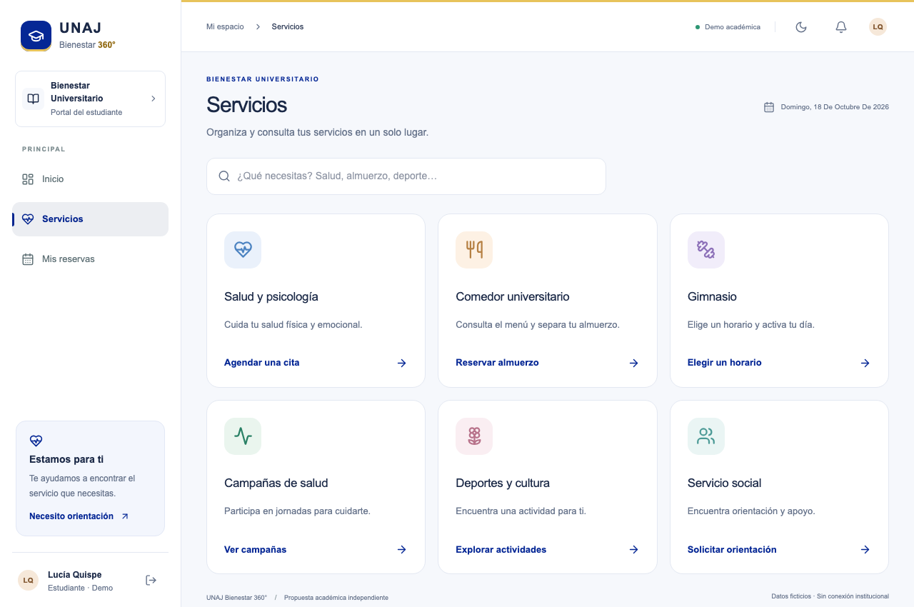

Gestión tiene accesos a los dominios operativos, a Gestión de calidad y a Indicadores y reportes. Solo ve las reservas autorizadas para sus roles; no obtiene acceso psicológico por tener rol médico. El técnico no tiene permisos operativos. El tipo de dominio define ocho roles, pero solo hay cuatro cuentas semilla y no existe una pantalla para configurar permisos.

---

## 1 Acceder y cerrar sesión

Objetivo. Ingresar con una cuenta ficticia y terminar la sesión.

Requisitos previos. Aplicativo iniciado; correo y contraseña de demostración.

1. Abra http://127.0.0.1:3000 en el navegador. En la verificación aislada se usó el puerto 3200.

2. Escriba estudiante@demo.local y la contraseña Demo360!2026. Seleccione Iniciar sesión.

3. Compruebe el saludo y el menú. Para salir, pulse el icono Cerrar sesión junto al perfil.

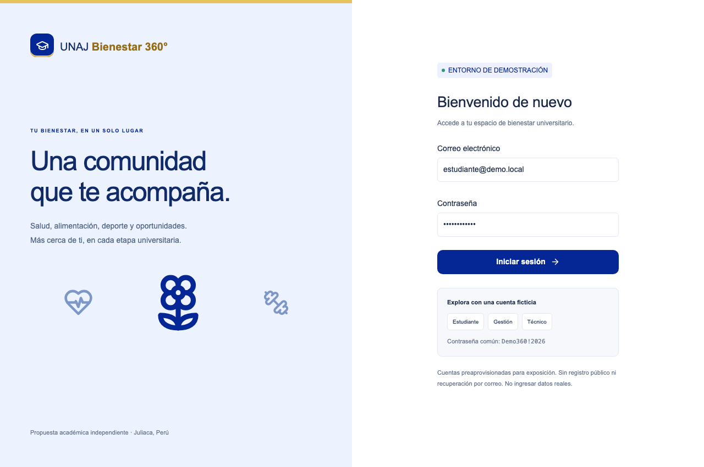

Resultado esperado. Se muestra Inicio para una cuenta válida; al cerrar sesión se vuelve al acceso.

Límite de uso. No existe registro público ni recuperación de contraseña. Las cuentas se aprovisionan como datos ficticios.

---

## 2 Elegir un servicio y reservar una cita

Objetivo. Reservar un horario de salud sin duplicar cupos.

Requisitos previos. Cuenta estudiantil activa; horario futuro con cupo disponible.

1. En Inicio pulse Salud y psicología, o entre a Servicios y busque salud.

2. Revise profesional ficticio, fecha, hora y cupos. Pulse Reservar mi lugar en el horario deseado.

3. Compruebe los datos del diálogo y pulse Confirmar reserva.

4. Lea la confirmación y abra Mis reservas o el enlace Ver mi reserva.

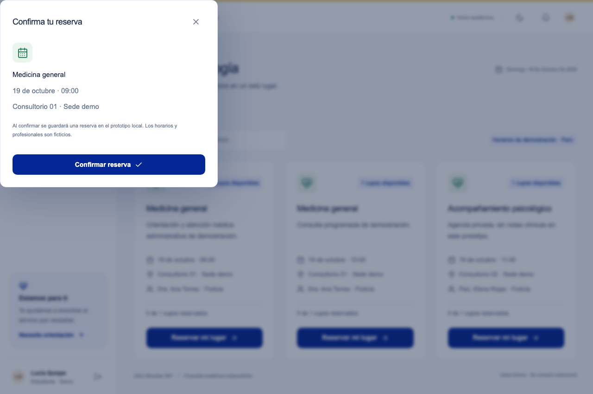

Resultado esperado. La cita queda CONFIRMADA y persiste al volver a consultar el servidor.

Límite de uso. Los bloques de conflicto de 60 minutos son una regla propuesta de demo. No representan una política oficial de la UNAJ.

---

## 3 Consultar una reserva y su QR

Objetivo. Presentar el código de una reserva propia.

Requisitos previos. Al menos una reserva guardada en la cuenta estudiantil.

1. Seleccione Mis reservas. Si está en móvil, use el acceso inferior.

2. Busque la fila del servicio y pulse Ver código.

3. Presente el QR o el código de texto al operador autorizado.

4. Cierre el diálogo con Cerrar diálogo o la tecla Escape.

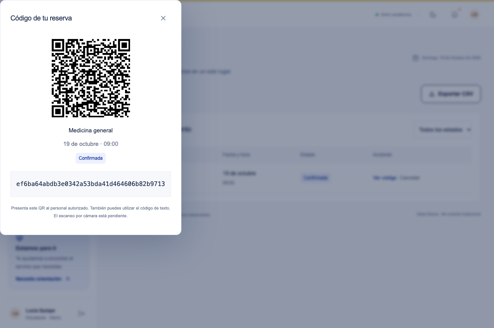

Resultado esperado. Se muestra un QR generado localmente y un token aleatorio de la reserva.

Límite de uso. El QR no es una credencial de inicio de sesión. El escaneo por cámara no está implementado; el operador introduce el código o contenido QR.

---

## 4 Cancelar una reserva

Objetivo. Liberar un cupo que ya no se utilizará.

Requisitos previos. Ser titular de una reserva confirmada o en espera; horario todavía no iniciado.

1. Abra Mis reservas y localice la fila correspondiente.

2. Pulse Cancelar y compruebe el nombre del servicio.

3. Pulse Confirmar cancelación.

4. Revise que el estado cambió a Cancelada. Puede consultar nuevamente los cupos en Servicios.

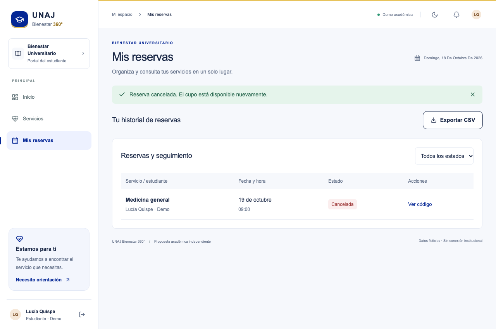

Resultado esperado. El estado pasa a CANCELADA y la reserva deja de consumir cupo.

Límite de uso. El servidor rechaza la cancelación ajena y la de un horario ya iniciado. Reprogramar requiere cancelar y reservar; no hay reprogramación atómica.

---

## 5 Inscribirse en una campaña

Objetivo. Separar un cupo en la campaña ficticia disponible.

Requisitos previos. Cuenta estudiantil; fecha futura; capacidad disponible.

1. Entre a Servicios y seleccione Campañas de salud.

2. Lea fecha, sede ficticia y cupos de Jornada de bienestar integral.

3. Pulse Reservar mi lugar y confirme los datos.

4. Abra Mis reservas para consultar el código de inscripción.

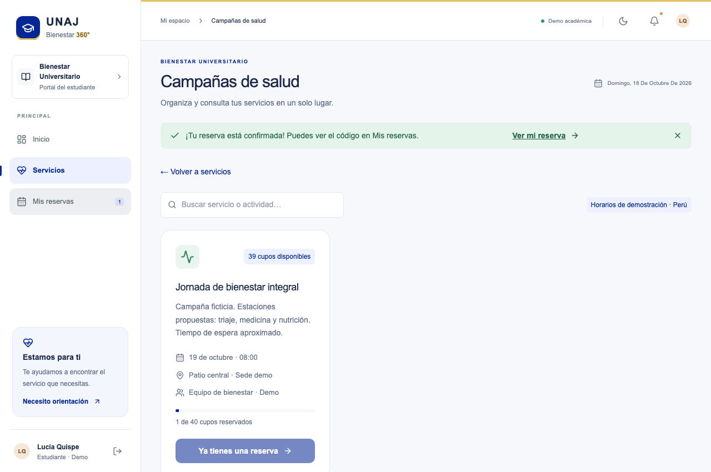

Resultado esperado. Existe una reserva confirmada vinculada a la campaña.

Límite de uso. No se puede crear una campaña desde la interfaz. Las estaciones citadas en la descripción son propuestas; no se realiza tránsito por estaciones.

---

## 6 Reservar el almuerzo

Objetivo. Registrar una reserva anticipada del menú de demostración.

Requisitos previos. Cuenta estudiantil; horario futuro; cupo libre y sin conflicto horario.

1. Entre a Servicios y seleccione Comedor universitario.

2. Consulte el menú ficticio y la fecha de atención.

3. Pulse Reservar mi lugar y luego Confirmar reserva.

4. Revise la reserva en Mis reservas y conserve su código para la entrega.

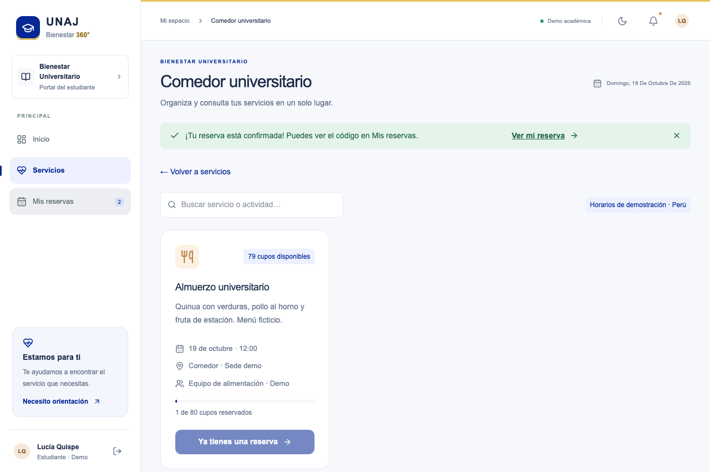

Resultado esperado. Se guarda una reserva de comedor con estado CONFIRMADA.

Límite de uso. El prototipo no valida beneficiarios ni criterios oficiales de elegibilidad. Reservar no equivale a haber recibido la ración.

---

## 7 Reservar un horario de gimnasio

Objetivo. Elegir una franja de entrenamiento disponible.

Requisitos previos. Cuenta estudiantil; horario futuro; cupo libre.

1. Entre a Servicios y seleccione Gimnasio.

2. Compare las franjas disponibles y revise la duración propuesta de 60 minutos.

3. Pulse Reservar mi lugar en una franja y confirme.

4. Consulte su código y espere a la fecha de la reserva para registrar la llegada.

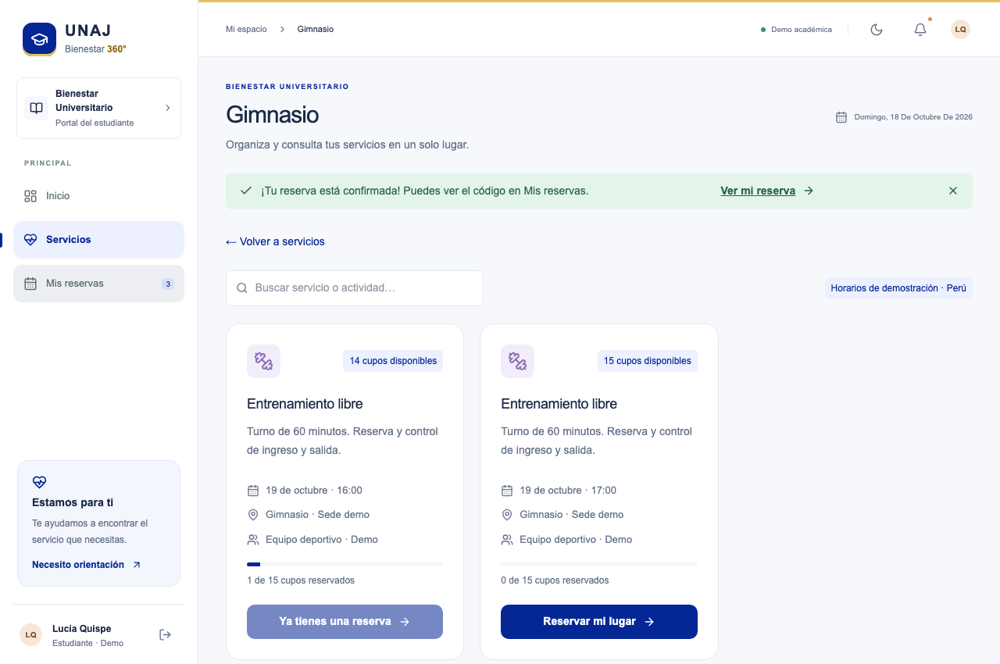

Resultado esperado. La reserva queda vinculada a una franja y consume un cupo de esa franja.

Límite de uso. Los cupos de reserva no son un sistema de aforo físico. El aplicativo no mide ocupación simultánea de instalaciones.

---

## 8 Solicitar orientación o elegir una actividad

Objetivo. Acceder a las alternativas de apoyo y participación disponibles.

Requisitos previos. Cuenta estudiantil; un recurso futuro disponible.

1. Abra Servicios. Seleccione Servicio social para orientación, o Deportes y cultura para el taller disponible.

2. Revise la información del recurso y su horario.

3. Reserve y confirme siguiendo el mismo diálogo de los demás servicios.

4. Consulte el estado en Mis reservas. No introduzca información socioeconómica real.

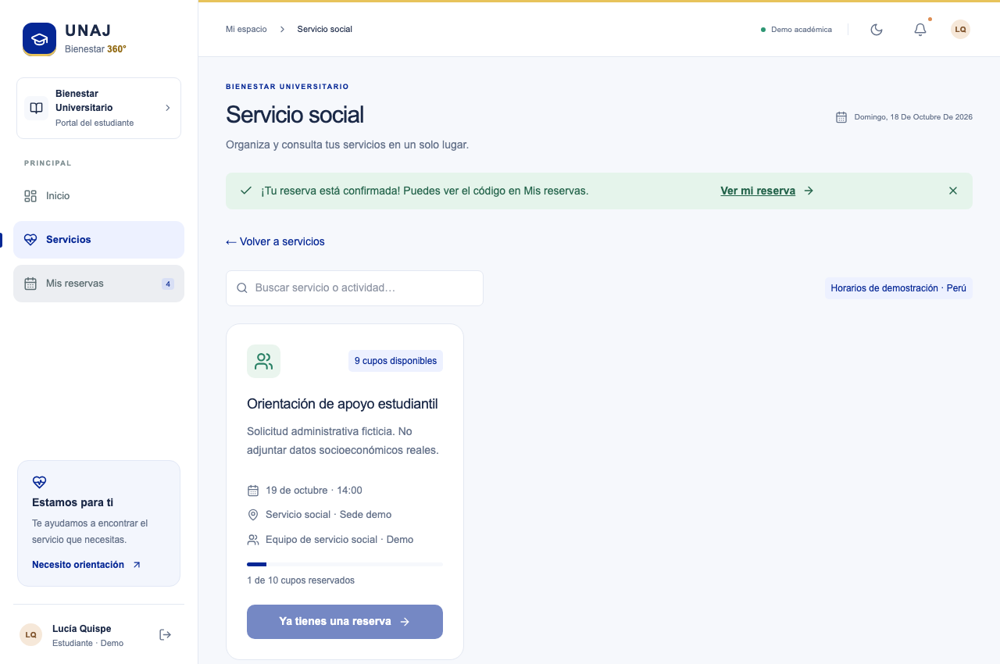

Resultado esperado. Se registra una reserva administrativa de orientación o actividad.

Límite de uso. Servicio social no incluye expediente, documentos ni evaluación de apoyos. El taller y su horario no se administran desde la interfaz.

---

## 9 Registrar llegada y atender un turno de campaña

Objetivo. Recorrer el flujo administrativo de atención de una inscripción.

Requisitos previos. Cuenta gestion@demo.local con rol médico; reserva confirmada; fecha de servicio igual al día actual.

1. En el menú de gestión abra Campañas de salud y ubique la reserva.

2. Pulse Registrar llegada e introduzca el código presentado por el estudiante.

3. Verifique En espera. Pulse Llamar turno para pasar a En atención.

4. Pulse Finalizar para registrar el cierre administrativo.

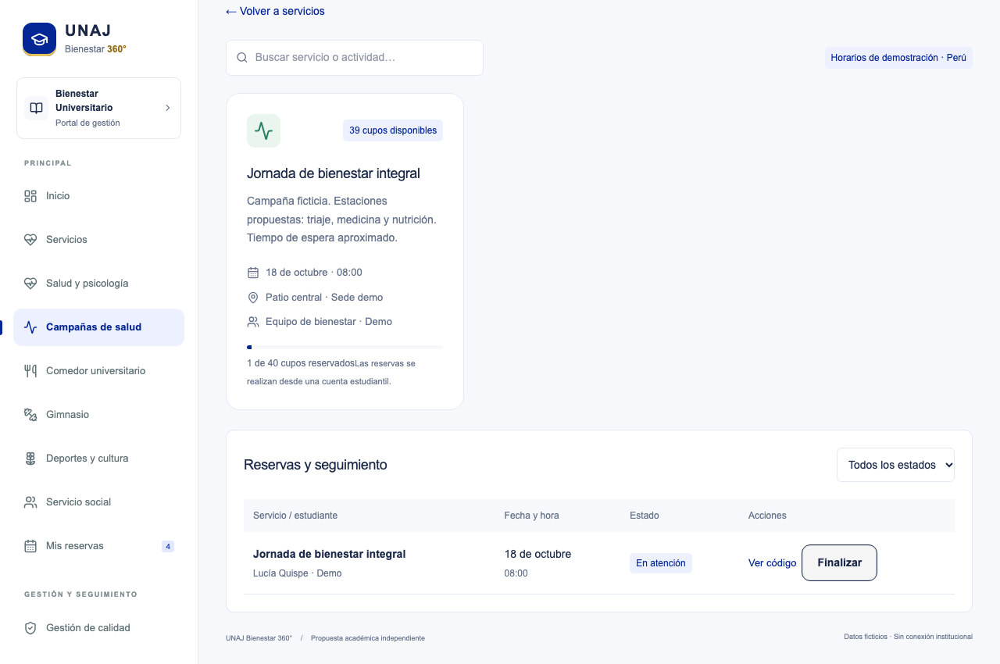

Resultado esperado. Se observa la secuencia CONFIRMADA → EN_ESPERA → EN_ATENCION → FINALIZADA.

Límite de uso. Llamar turno actúa sobre la fila elegida; no selecciona automáticamente el siguiente ni calcula espera. La prioridad clínica y las urgencias quedan fuera del prototipo.

---

## 10 Entregar una ración y registrar producción

Objetivo. Verificar consumo único y distinguir producción de residuos.

Requisitos previos. Cuenta de gestión con rol comedor; reserva confirmada del día para entregar; datos de producción ficticios.

1. Abra Comedor universitario y pulse Entregar ración en la reserva correspondiente. Introduzca el código del estudiante.

2. Compruebe el estado Ración entregada. El sistema no admite una segunda transición de entrega.

3. En Producción y desperdicio registre raciones preparadas y entregadas; registre por separado kg aprovechables y kg de residuos.

4. Pulse Guardar registro y revise las cantidades. Use 20, 18, 1.2 y 0.4 solo como ejemplo ficticio.

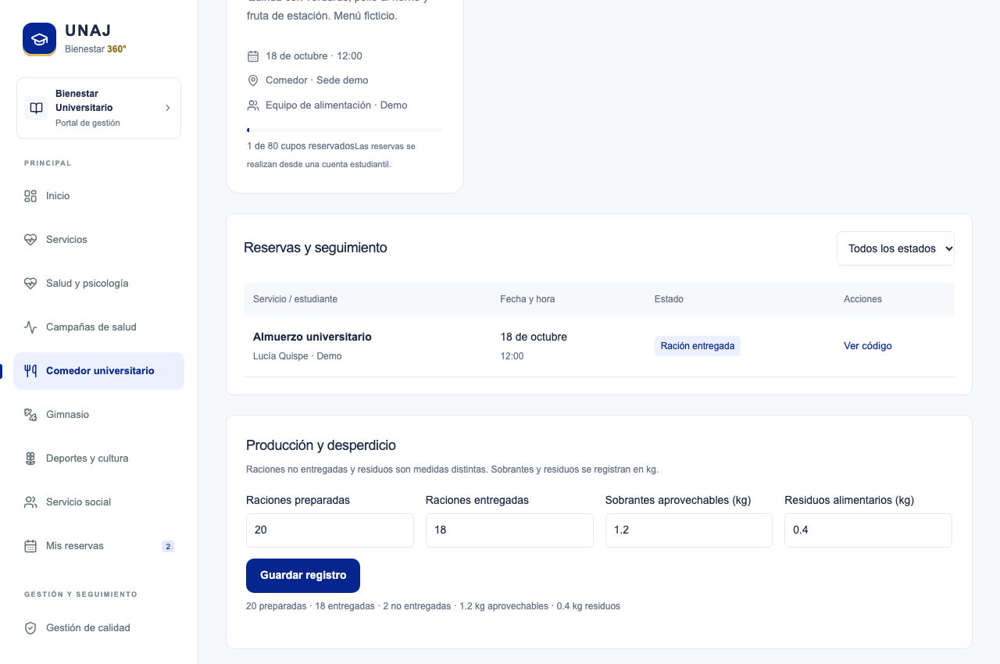

Resultado esperado. La entrega queda CONSUMIDA y el registro de producción se conserva por separado.

Límite de uso. El registro manual de producción no se reconcilia automáticamente con entregas individuales. Dos raciones no entregadas no significan dos raciones desperdiciadas.

---

## 11 Registrar ingreso y salida administrativa del gimnasio

Objetivo. Actualizar los estados del turno de gimnasio.

Requisitos previos. Cuenta de gestión con rol gimnasio; reserva confirmada del día; código válido.

1. Abra Gimnasio y pulse Registrar llegada en la fila correspondiente.

2. Introduzca el código del estudiante para pasar a En espera.

3. Pulse Llamar turno para pasar a En atención. Este paso representa el inicio administrativo del uso.

4. Al terminar pulse Finalizar; internamente se procesa la acción de salida del gimnasio.

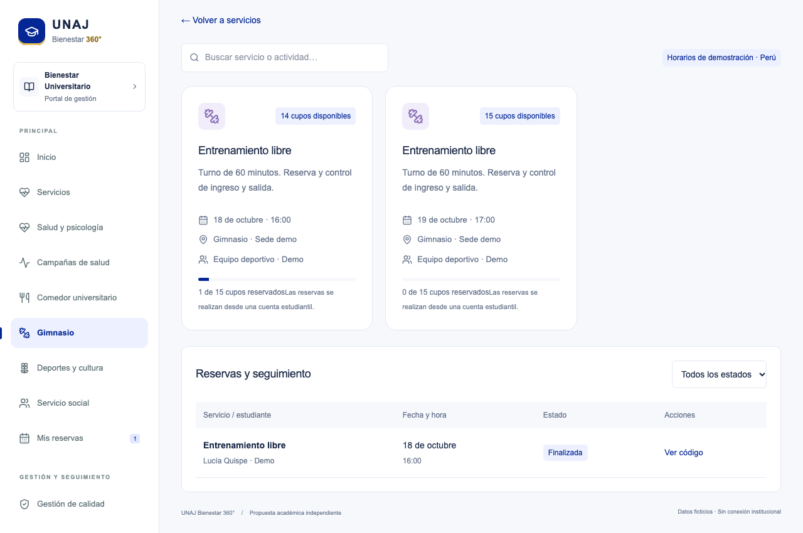

Resultado esperado. El turno termina como FINALIZADA y queda un registro de auditoría.

Límite de uso. No hay barrera física, sensor, contador de aforo en vivo ni cálculo de ocupación promedio.

---

## 12 Crear una acción de mejora

Objetivo. Registrar un problema propuesto y un responsable de seguimiento.

Requisitos previos. Cuenta de gestión con rol calidad; título y descripción sin datos sensibles.

1. Abra Gestión de calidad y pulse Nueva acción.

2. Escriba un título de al menos 8 caracteres y una descripción de al menos 10.

3. Indique responsable y fecha límite. Identifique como ficticio cualquier caso de exposición.

4. Pulse Guardar acción y compruebe la columna En curso.

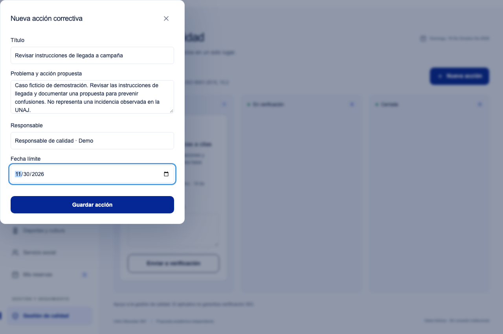

Resultado esperado. Se guarda una acción con estado EN_CURSO, responsable y fecha límite.

Límite de uso. El formulario no documenta una no conformidad completa ni su análisis causal. La descripción debe aclarar el contexto y la evidencia disponible.

---

## 13 Registrar ejecución y verificar una acción

Objetivo. Conservar evidencias antes de cerrar una acción.

Requisitos previos. Acción en curso; rol calidad; evidencia textual de al menos 10 caracteres en cada paso.

1. En la tarjeta escriba Evidencia de ejecución y pulse Enviar a verificación.

2. En En verificación, registre Evidencia de eficacia. En una demo indique explícitamente que la evidencia es simulada.

3. Pulse Verificar eficacia y cerrar.

4. Compruebe que la tarjeta aparece en Cerrada. El historial técnico conserva ambas evidencias.

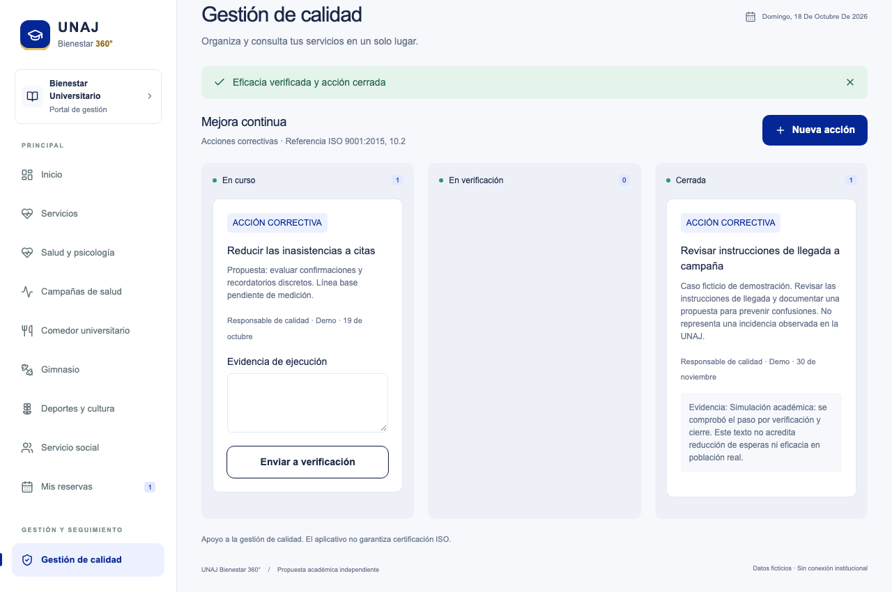

Resultado esperado. La acción recorre EN_CURSO → EN_VERIFICACION → CERRADA.

Límite de uso. El sistema valida estado y longitud de texto; no comprueba verdad, suficiencia ni eficacia real. El mismo perfil puede ejecutar y cerrar; no hay verificación independiente.

---

## 14 Consultar indicadores y exportar registros

Objetivo. Revisar conteos operativos y descargar datos visibles para el rol.

Requisitos previos. Cuenta de gestión; datos ficticios registrados.

1. Abra Indicadores y reportes.

2. Revise reservas registradas, atenciones completas y barras por servicio. Satisfacción debe aparecer Sin datos.

3. Pulse Exportar datos y guarde el archivo CSV.

4. Compare las filas con los registros visibles. Para filtrar estados use Reservas y seguimiento.

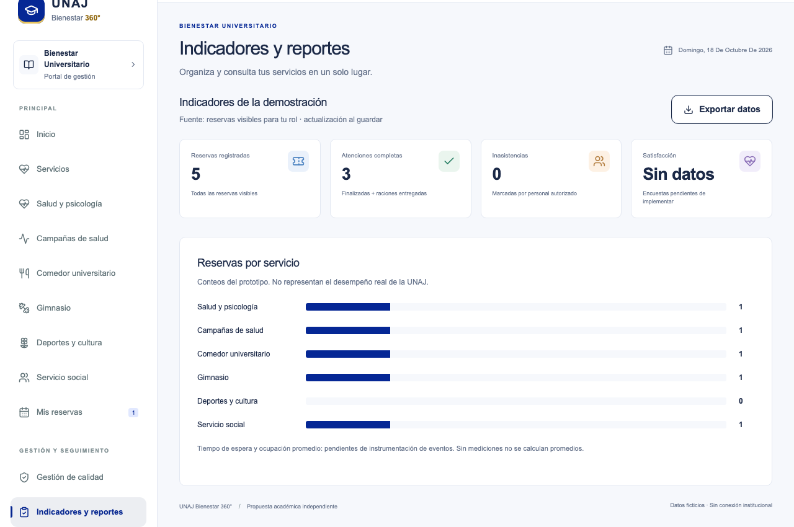

Resultado esperado. Se descarga un CSV con reserva, servicio, fecha, hora y estado.

Límite de uso. La página no mide espera media ni satisfacción. Los reportes son por permisos del actor; no representan automáticamente el total institucional.

---

## Solución de problemas y preguntas frecuentes

| Situación | Qué revisar |
| --- | --- |
| No abre la aplicación | Compruebe que npm run dev continúa activo y que el puerto sea el mostrado en la terminal. |
| Correo o contraseña incorrectos | Use una de las cuentas ficticias indicadas. Tras varios intentos fallidos, espere 15 minutos. |
| Este horario ya ha pasado | Los horarios se crean una sola vez al aprovisionar la base. No existe agenda editable; prepare otra base ficticia para exposición. |
| No quedan cupos o reserva duplicada | Elija otra franja. La capacidad y los duplicados se validan en el servidor. |
| Otra reserva coincide | Seleccione una franja separada al menos 60 minutos según la regla de demo. |
| No se puede registrar llegada o entrega | Compruebe rol, código y que la fecha del servicio coincida con el día actual en Perú. |
| Sin permiso o espacio restringido | Cambiar el menú no concede permisos. Ingrese con la cuenta adecuada para el proceso. |

### Preguntas frecuentes

¿Puedo registrarme o recuperar acceso por correo? No. Las cuentas son preaprovisionadas y no hay recuperación por correo. ¿El QR se escanea con cámara? No; se verifica introduciendo el código o contenido QR. ¿Puedo editar campañas, menús y horarios? No desde esta interfaz; son datos semilla. ¿Puedo guardar información médica? No: el prototipo es administrativo y solo debe usarse con datos ficticios.

---

## Glosario y conclusiones

| Término | Significado en esta versión |
| --- | --- |
| Reserva | Asignación de un cupo de recurso y horario a una cuenta. |
| Turno | Estado administrativo de espera y atención de una reserva. |
| QR | Representación de un identificador y un token de verificación. |
| Cupo | Capacidad de una franja; no equivale al aforo físico en vivo. |
| Idempotencia | Repetir la misma solicitud no crea una segunda reserva. |
| Ración no entregada | Diferencia entre raciones preparadas y entregadas; no es kg de desperdicio. |
| Evidencia | Texto registrado por una persona; necesita revisión externa de suficiencia. |
| PHVA | Planificar, Hacer, Verificar y Actuar, usado aquí como marco de análisis. |

### Conclusiones

La versión permite demostrar un flujo administrativo consistente desde una reserva hasta su atención y el registro de acciones de seguimiento. Las pantallas simplifican la navegación, pero no sustituyen políticas, responsabilidades ni evaluaciones de calidad. El uso correcto exige respetar permisos, fechas y datos ficticios, y explicar las capacidades pendientes durante la exposición.
